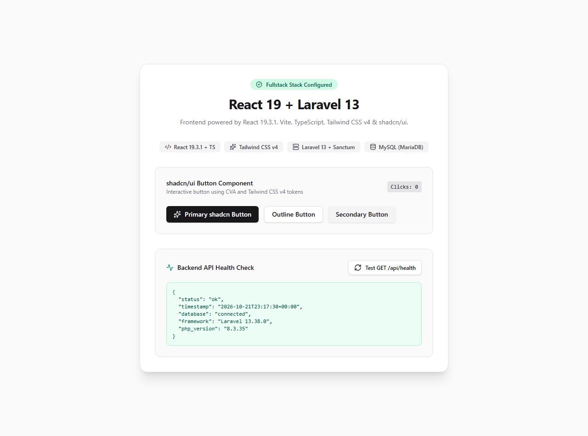

# Fullstack Application: React 19 + Laravel 13

A fullstack application consisting of a React 19 TypeScript frontend built with Vite, Tailwind CSS v4, and shadcn/ui, paired with a Laravel 13 backend powered by PHP 8.3 and MariaDB (MySQL) via XAMPP.



---

## Versions & Technology Stack

| Component | Technology | Version |
|---|---|---|
| **Frontend Framework** | React | 19.3.1 |
| **Frontend Build Tool** | Vite | 8.3.5 |
| **Language (Frontend)** | TypeScript | ~6.0.3 |
| **CSS Framework** | Tailwind CSS | v4.0.0 (`@tailwindcss/vite`) |
| **UI Components** | shadcn/ui (Button) | Radix UI Slot + CVA |
| **Backend Framework** | Laravel | 13.38.0 |
| **Backend Runtime** | PHP | 8.3.35 (CLI & ZTS) |
| **Package Manager** | Composer | 2.11-dev |
| **API Authentication** | Laravel Sanctum | v4.3.3 |
| **Database** | MariaDB (MySQL via XAMPP) | 10.4.18 |
| **Node.js Runtime** | Node.js / npm | v24.20.0 / 11.19.0 |

---

## Project Structure

```
project/
├── backend/                  # Laravel 13 API backend
│   ├── app/Models/User.php   # User model with HasApiTokens trait
│   ├── routes/api.php        # Contains GET /api/health endpoint
│   ├── config/cors.php       # CORS configuration for API
│   ├── .env                  # Configured with MySQL credentials
│   └── database/migrations/  # Database migrations
├── frontend/                 # React 19.3.1 + Vite + TypeScript frontend
│   ├── src/
│   │   ├── components/ui/    # shadcn/ui Button component
│   │   ├── lib/utils.ts      # Class merging utility (clsx + twMerge)
│   │   ├── App.tsx           # UI displaying shadcn Button & live health check
│   │   └── index.css         # Tailwind CSS v4 stylesheet
│   ├── vite.config.ts        # Configured with @tailwindcss/vite
│   └── package.json
└── README.md
```

---

## Database Configuration (XAMPP / MariaDB)

### 1. Starting MySQL in XAMPP
Open the **XAMPP Control Panel** (`C:\xampp\xampp-control.exe`) and click **Start** next to MySQL.
Alternatively, from PowerShell:
```powershell
C:\xampp\mysql\bin\mysqld.exe --defaults-file=C:\xampp\mysql\bin\my.ini --standalone
```

### 2. Creating `fullstack_db`
- **Via phpMyAdmin**: Open `http://localhost/phpmyadmin` in your browser, click **New**, enter `fullstack_db`, and click **Create**.
- **Via MySQL CLI**:
  ```powershell
  C:\xampp\mysql\bin\mysql.exe -u root -e "CREATE DATABASE IF NOT EXISTS fullstack_db CHARACTER SET utf8mb4 COLLATE utf8mb4_unicode_ci;"
  ```

### 3. Backend `.env` Configuration
The `backend/.env` file is set with standard XAMPP credentials:
```env
DB_CONNECTION=mysql
DB_HOST=127.0.0.1
DB_PORT=3306
DB_DATABASE=fullstack_db
DB_USERNAME=root
DB_PASSWORD=
```

---

## Quick Start Commands

### Backend (`backend/`)

1. **Navigate to backend**:
   ```bash
   cd backend
   ```

2. **Run Migrations**:
   ```bash
   php artisan migrate
   ```

3. **Start the Laravel Server**:
   ```bash
   php artisan serve --host=127.0.0.1 --port=8000
   ```

4. **Verify Health Endpoint**:
   ```bash
   curl http://127.0.0.1:8000/api/health
   ```
   **Expected JSON Response:**
   ```json
   {
     "status": "ok",
     "timestamp": "2026-10-21T22:29:53+00:00",
     "database": "connected",
     "framework": "Laravel 13.38.0",
     "php_version": "8.3.35"
   }
   ```

---

### Frontend (`frontend/`)

1. **Navigate to frontend**:
   ```bash
   cd frontend
   ```

2. **Install Dependencies** (if needed):
   ```bash
   npm install
   ```

3. **Start Vite Development Server**:
   ```bash
   npm run dev
   ```
   Access the frontend at `http://127.0.0.1:5173`.

4. **Build Production Bundle**:
   ```bash
   npm run build
   ```
